# FinGate v2 — Đặc tả nghiệp vụ

> Hệ thống điều hành dòng tiền & phê duyệt thu – chi cho **Tổng công ty và các công ty con**.
> Tài liệu này mô tả lại **toàn bộ hoạt động hệ thống** theo hướng nghiệp vụ: đối tượng, quy trình, user story, sơ đồ.
> Nghiệp vụ v1 được giữ nguyên trừ khi ghi rõ **[v2 — MỚI]** hoặc **[v2 — THAY ĐỔI]**.
>
> Tài liệu kỹ thuật v1 tham chiếu: `docs/01_Blueprint.md`, `docs/03_screens.md`, `docs/04_architecture.md`.

---

## Mục lục

1. [Tổng quan & mục tiêu](#1-tổng-quan--mục-tiêu)
2. [Đối tượng nghiệp vụ](#2-đối-tượng-nghiệp-vụ)
3. [Tổ chức, nhân sự & phân quyền](#3-tổ-chức-nhân-sự--phân-quyền)
4. [Tài khoản tiền](#4-tài-khoản-tiền)
5. [Đối tác](#5-đối-tác-v2--mới) **[MỚI]**
6. [Phiếu thu / Phiếu chi](#6-phiếu-thu--phiếu-chi)
7. [Quy trình phê duyệt](#7-quy-trình-phê-duyệt)
8. [Thực thi & sổ cái dòng tiền](#8-thực-thi--sổ-cái-dòng-tiền)
9. [Công nợ (phải thu / phải trả)](#9-công-nợ-phải-thu--phải-trả)
10. [Nợ ngân hàng & đảo hạn](#10-nợ-ngân-hàng--đảo-hạn)
11. [Liên kết nghiệp vụ & quy trình tự động](#11-liên-kết-nghiệp-vụ--quy-trình-tự-động-v2--mới) **[MỚI]**
12. [Điều hành: Dashboard, dòng tiền, cảnh báo, bản tin, báo cáo](#12-điều-hành-dashboard-dòng-tiền-cảnh-báo-bản-tin-báo-cáo)
13. [Quản trị hệ thống](#13-quản-trị-hệ-thống)
14. [Mô hình dữ liệu v2](#14-mô-hình-dữ-liệu-v2)
15. [Chuyển đổi dữ liệu v1 → v2](#15-chuyển-đổi-dữ-liệu-v1--v2)
16. [Danh mục user story](#16-danh-mục-user-story)
17. [Quyết định đã chốt](#17-quyết-định-đã-chốt)

---

## 1. Tổng quan & mục tiêu

Mỗi ngày Ban Giám đốc mở hệ thống là biết ngay:

- Có **khoản thu/chi nào đang chờ mình duyệt**, đang nằm ở bàn ai.
- Mỗi công ty đang có **bao nhiêu tiền** ở từng quỹ tiền mặt / tài khoản ngân hàng.
- **Nợ ngân hàng** đang bao nhiêu, khoản nào sắp **đáo hạn / cần đảo hạn**.
- **Công nợ** phải thu / phải trả theo từng đối tác, khoản nào quá hạn.
- **Dòng tiền dự kiến** 7/30/60/90 ngày, ngày nào có nguy cơ thiếu tiền.

Nguyên tắc xuyên suốt (giữ từ v1):

| Nguyên tắc | Ý nghĩa |
| --- | --- |
| Không chỉ duyệt, phải kiểm soát | Mỗi khoản chi trả lời được: chi cho ai, bao nhiêu, để làm gì, căn cứ chứng từ nào, lấy từ tài khoản nào, sau khi chi còn bao nhiêu, có trong kế hoạch không. |
| Không âm thầm thay đổi | Mọi thao tác ghi lịch sử (audit), không xoá lịch sử; sau khi duyệt dữ liệu không đổi lặng lẽ. |
| Tiền chỉ dịch chuyển khi **thực thi** | Số dư thực = tổng bút toán sổ cái; duyệt chỉ ảnh hưởng số dư **dự kiến**. |
| Dữ liệu theo công ty | Mọi bản ghi nghiệp vụ thuộc đúng một công ty; người dùng chỉ thấy công ty mình được gán (trừ cấp Tổng công ty). |

**Trọng tâm v2:**

1. Làm rõ các **đối tượng nghiệp vụ** và quan hệ giữa chúng.
2. Đưa **Đối tác** thành đối tượng trung tâm (Ngân hàng / Khách hàng / Nhà cung cấp) — mọi phiếu thu/chi, công nợ, nợ ngân hàng đều gắn đối tác.
3. Thêm **Tags** cho phiếu thu/chi.
4. Thiết kế **liên kết nghiệp vụ** và **bộ máy quy trình tự động** dùng chung, để thêm quy trình mới mà không phải sửa mô hình dữ liệu.

### 1.1 Sơ đồ ngữ cảnh

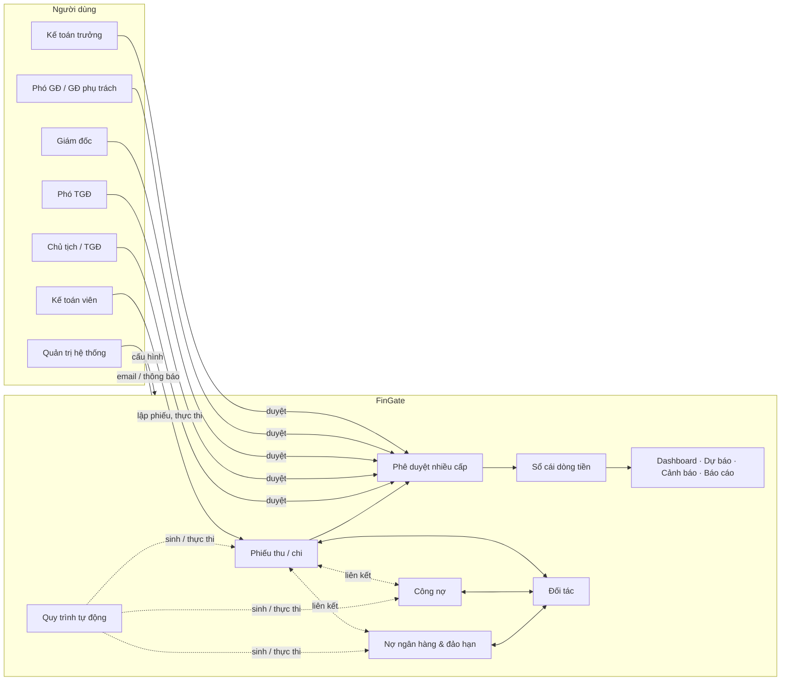

---

## 2. Đối tượng nghiệp vụ

### 2.1 Danh sách đối tượng

| # | Đối tượng | Thuộc về | Mô tả ngắn |
| --- | --- | --- | --- |
| O1 | **Tổng công ty** | Hệ thống | Công ty mẹ (cấp Tập đoàn). Có tài khoản tiền riêng, xem tổng hợp mọi công ty con. |
| O2 | **Công ty con** | Tổng công ty | Đơn vị hạch toán. Mọi dữ liệu nghiệp vụ gắn với một công ty. |
| O3 | **Bộ phận** | Công ty | Phòng ban, dùng cho phiếu & báo cáo theo bộ phận. |
| O4 | **Nhân sự** | Hệ thống | Một người, một email, một tài khoản đăng nhập. |
| O5 | **Phân công** | Nhân sự × Công ty | Nhân sự giữ chức danh ở một công ty (bộ phận, hạn mức, quyền bù/trừ). Một nhân sự có nhiều phân công. |
| O6 | **Tài khoản tiền** | Công ty / Tổng công ty | Quỹ **tiền mặt** hoặc tài khoản **ngân hàng**. |
| O7 | **Đối tác** **[MỚI]** | Công ty | Ngân hàng / Khách hàng / Nhà cung cấp. |
| O8 | **Tag** **[MỚI]** | Công ty | Nhãn tự do gắn phiếu thu/chi. |
| O9 | **Phiếu thu** | Công ty | Đề nghị/ghi nhận tiền vào một tài khoản tiền, từ một đối tác. |
| O10 | **Phiếu chi** | Công ty | Đề nghị/ghi nhận tiền ra từ một tài khoản tiền, cho một đối tác. |
| O11 | **Phiếu đảo hạn** | Công ty | Phương án đảo hạn một khoản nợ ngân hàng, qua phê duyệt. |
| O12 | **Khoản công nợ** | Công ty, gắn Đối tác KH/NCC | Mỗi khoản có **hướng** *Phải thu* hoặc *Phải trả*, chọn độc lập với loại đối tác — KH hay NCC đều có thể phát sinh cả phải thu lẫn phải trả. |
| O13 | **Khoản nợ ngân hàng** | Công ty, gắn Đối tác NH | Khoản vay: gốc, lãi suất, kỳ hạn, hạn thanh toán, lịch trả. |
| O14 | **Bút toán sổ cái** | Tài khoản tiền | Một lần tiền vào/ra thực tế. Chỉ thêm, không sửa/xoá. |
| O15 | **Liên kết nghiệp vụ** **[MỚI]** | Công ty | Quan hệ có ý nghĩa nghiệp vụ giữa 2 đối tượng (cấn trừ, giải ngân, trả nợ, vay để chi…). |
| O16 | **Quy tắc tự động / Lượt chạy** **[MỚI]** | Hệ thống / Công ty | Quy trình tự sinh/thực thi đối tượng khi có sự kiện. |
| O17 | Danh mục thu/chi, Ngân sách, Khoản chi định kỳ, Approval Matrix, Uỷ quyền, Cảnh báo, Thông báo, Audit log | — | Như v1. |

### 2.2 Sơ đồ quan hệ (ER mức nghiệp vụ)

Ký hiệu bản số: `||` đúng một · `|o` không hoặc một · `o{` không hoặc nhiều · `|{` một hoặc nhiều. Mọi liên kết giữa các đối tượng đi qua **ID**.

#### 2.2a Tổ chức & nhân sự

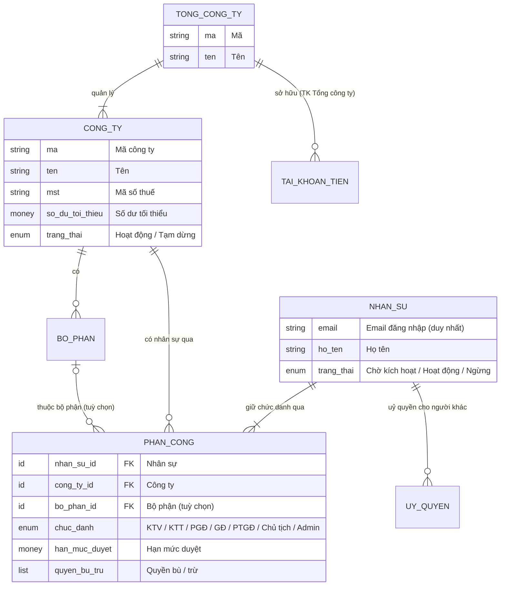

> Một nhân sự có **nhiều phân công** (mỗi công ty một phân công) ⇒ cùng một chức danh ở nhiều công ty, bộ phận chọn theo từng công ty.

#### 2.2b Tiền, đối tác & nghiệp vụ (trong một công ty)

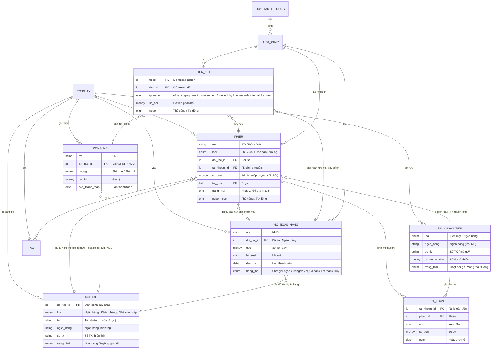

> Chỉ tiêu *đã cấn trừ*, *còn phải thu/phải trả*, *dư nợ* **không lưu**: tính từ Liên kết nghiệp vụ còn hiệu lực + trạng thái phiếu đã thực thi. Số dư tài khoản = Σ bút toán sổ cái.

### 2.3 Quy tắc chung cho mọi đối tượng nghiệp vụ

- Thuộc đúng **một công ty** (`company_id`); Tổng công ty cũng là một công ty (`is_group = true`).
- Có **mã tự sinh** không trùng (VD `PT-2026-00012`, `PC-…`, `CN-…`, `NHD-…`, `DT-…`), không sửa sau khi gửi/kích hoạt.
- Có **lịch sử thay đổi** (ai, khi nào, trước → sau, IP) — chỉ thêm.
- **Không xoá vật lý** đối tượng đã phát sinh tiền / đã duyệt; dùng trạng thái Huỷ / Lưu trữ / Ngừng.
- Có **đính kèm chứng từ** (PDF, Excel, Word, JPG/PNG), có phiên bản, file đã được tham chiếu khi duyệt thì chỉ thêm không xoá.
- Có **nguồn gốc**: `Thủ công` hoặc `Tự động` (kèm quy tắc & lượt chạy đã sinh ra nó) **[MỚI]**.

---

## 3. Tổ chức, nhân sự & phân quyền

### 3.1 Mô hình tổ chức (như v1)

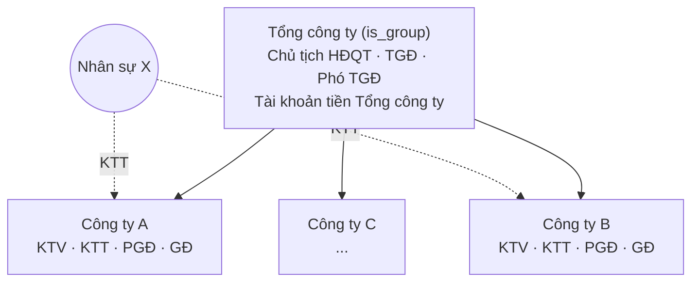

- **1 Tổng công ty → nhiều công ty con**; mỗi công ty con có bộ nhân sự riêng.
- **Một nhân sự có thể thuộc nhiều công ty**: chức danh/vai trò và hạn mức dùng chung, **bộ phận chọn theo từng công ty** (mỗi công ty là một *Phân công*).
- Người dùng đa công ty chọn **phạm vi**: "Tất cả công ty" hoặc một công ty cụ thể; dữ liệu lọc theo phạm vi.

### 3.2 Chức danh & quyền chính

| Chức danh | Mã | Lập phiếu | Duyệt | Thực thi | Quản lý đối tác / công nợ / nợ NH | Quản trị |
| --- | --- | --- | --- | --- | --- | --- |
| Kế toán viên | `staff` | ✔ | – | ✔ | ✔ (tạo/sửa) | – |
| Kế toán trưởng | `chief_accountant` | ✔ | ✔ cấp 1 | ✔ | ✔ (toàn quyền) | – |
| Phó GĐ / GĐ phụ trách | `deputy_director` | – | ✔ | – | xem | – |
| Giám đốc công ty | `director` | – | ✔ | – | xem | mời nhân sự công ty mình |
| Phó TGĐ | `deputy_chairman` | – | ✔ | – | xem | – |
| Chủ tịch / TGĐ | `chairman` | – | ✔ cấp cuối | – | xem toàn hệ thống | nhân sự, matrix, TK Tổng công ty |
| Quản trị hệ thống | `admin` | – | – | – | – | cấu hình, sao lưu |

Quyền thực tế = quyền của vai trò **+ quyền bù − quyền trừ** trên từng phân công. v2 bổ sung quyền:

| Quyền mới | Ý nghĩa |
| --- | --- |
| `partner:read` / `partner:write` | Xem / tạo-sửa-ngừng đối tác (đã có ở v1, nay áp cho màn Đối tác đầy đủ). |
| `tag:create` | Tạo tag mới ngay trên phiếu (mặc định: ai có `doc:create`). |
| `tag:manage` | Đổi tên / gộp / ẩn tag (mặc định: KTT). |
| `automation:config` | Bật/tắt, chỉnh tham số quy tắc tự động (mặc định: Chủ tịch, Admin). |
| `link:manage` | Gán / gỡ liên kết thủ công giữa phiếu – công nợ – nợ ngân hàng (mặc định: KTV, KTT). |

### 3.3 Vòng đời nhân sự (như v1)

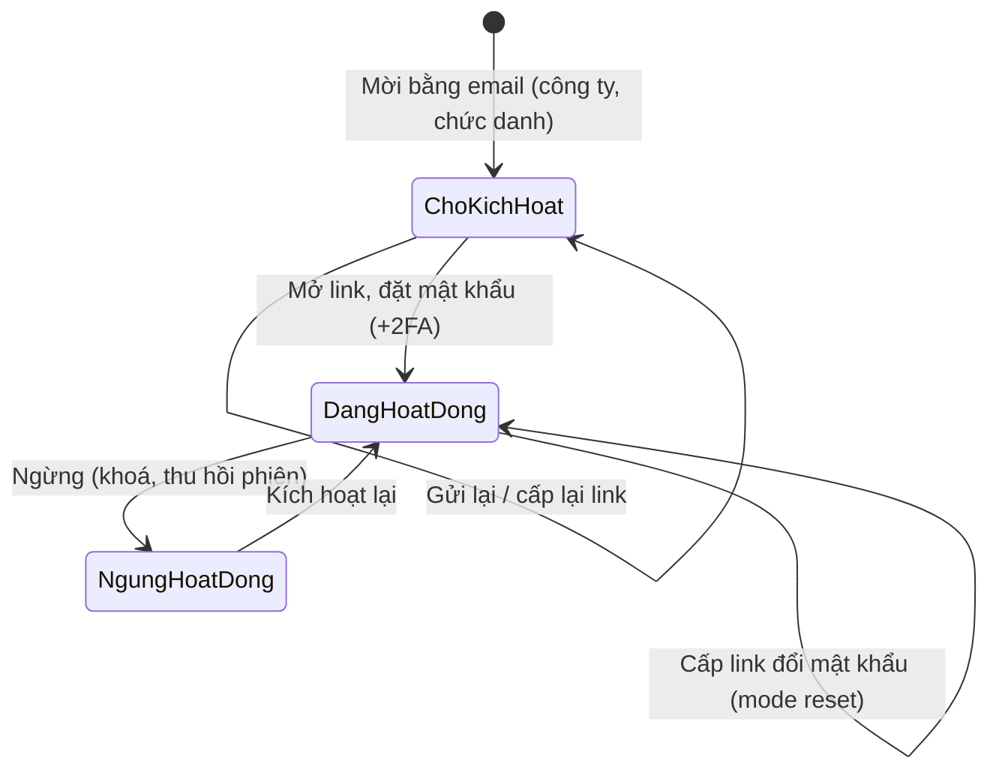

- Chủ tịch thêm/ngừng nhân sự mọi công ty; Giám đốc công ty con chỉ **mời** vào công ty mình.
- Ngừng/chuyển nhân sự đang là cấp duyệt của hồ sơ chờ → cảnh báo & chỉ định người thay thế. **Uỷ quyền** duyệt có thời hạn và lý do.
- Bảo mật: 2FA (TOTP + mã khôi phục), khoá tạm khi sai mật khẩu nhiều lần, phiên trượt + trần tuyệt đối, log đăng nhập.

**User stories**

- **US-ORG-01** — Là *Chủ tịch*, tôi muốn mời một nhân sự bằng email vào một hoặc nhiều công ty với chức danh xác định, để họ tự kích hoạt tài khoản mà không cần tôi tạo mật khẩu.
- **US-ORG-02** — Là *Kế toán trưởng phụ trách 2 công ty*, tôi muốn chuyển phạm vi giữa "Tất cả" và từng công ty, để làm việc trên một tài khoản duy nhất.
- **US-ORG-03** — Là *Giám đốc công ty con*, tôi muốn mời nhân sự vào công ty mình (không chọn được công ty khác).
- **US-ORG-04** — Là *Chủ tịch*, khi ngừng một nhân sự đang giữ hồ sơ chờ duyệt, tôi muốn được yêu cầu chỉ định người thay thế để hồ sơ không bị treo.

---

## 4. Tài khoản tiền

### 4.1 Định nghĩa

Tài khoản tiền là nơi tiền **thực sự nằm**. Hai loại:

| Loại | Ví dụ | Trường riêng |
| --- | --- | --- |
| **Tiền mặt** (`cash`) | Quỹ tiền mặt văn phòng HN | Tên quỹ, mã quỹ |
| **Ngân hàng** (`bank`) | VCB – 0011 0000 1234 | Ngân hàng, chi nhánh, số TK, tên chủ TK |

Trường chung (như v1): công ty sở hữu (hoặc Tổng công ty), tiền tệ, người phụ trách, hạn mức (nếu có), **số dư tối thiểu**, hiển thị trên Dashboard, trạng thái (`Hoạt động` / `Phong toả` / `Đóng`), ghi chú.

### 4.2 Số dư

| Chỉ tiêu | Nguồn |
| --- | --- |
| Số dư thực tế | Σ bút toán sổ cái (vào − ra) đến ngày |
| Đầu ngày / vào / ra / cuối ngày | Bảng số dư ngày, dựng lại từ sổ cái |
| Dự kiến vào / ra | Phiếu đã gửi duyệt nhưng chưa thực thi, theo ngày dự kiến |
| Vi phạm tối thiểu | Số dư cuối ngày (thực tế hoặc dự kiến) < số dư tối thiểu → cảnh báo |

> **[v2 — BỎ]** Không còn theo dõi *tiền bị phong toả* và *số dư khả dụng* (v1 nhập tay). Số dư dùng cho kiểm soát, dashboard, dự báo = số dư thực tế/dự kiến từ sổ cái.

- Có thể **nhập sao kê** ngân hàng để **đối chiếu** (không ghi sổ), phát hiện chênh lệch.
- Tài khoản **Tổng công ty**: chỉ Chủ tịch cấu hình. Phiếu của công ty con có thể dùng tài khoản Tổng công ty (ghi rõ "Tài khoản Tổng công ty phụ trách").
- Khoá/đóng tài khoản → không chọn được cho phiếu mới, cảnh báo các phiếu đang chờ có tham chiếu.

> **[v2 — làm rõ]** Tài khoản tiền **không phải** đối tác. Ngân hàng nơi công ty mở tài khoản tiền gửi chỉ là thuộc tính "Ngân hàng" của tài khoản; còn **ngân hàng cho vay** là **Đối tác loại Ngân hàng** (mục 5). Một ngân hàng có thể vừa là nơi mở tài khoản vừa là đối tác cho vay — hai bản ghi khác nhau, liên kết qua tên ngân hàng (gợi ý, không bắt buộc).

**User stories**

- **US-ACC-01** — Là *KTT*, tôi muốn khai báo quỹ tiền mặt và tài khoản ngân hàng của công ty với số dư tối thiểu, để hệ thống cảnh báo khi xuống dưới ngưỡng.
- **US-ACC-02** — Là *Giám đốc*, tôi muốn xem số dư thực tế và dự kiến của từng tài khoản trong một màn hình.
- **US-ACC-03** — Là *KTV*, tôi muốn xem lịch sử giao dịch của một tài khoản (mỗi dòng trỏ về phiếu đã sinh ra nó).
- **US-ACC-04** — Là *KTT*, tôi muốn nhập sao kê để đối chiếu với sổ cái và thấy các dòng lệch.

---

## 5. Đối tác [v2 — MỚI]

### 5.1 Định nghĩa

Đối tác là **bên ngoài công ty** mà công ty thu tiền, chi tiền, ghi nợ hoặc vay nợ.

| Trường | Bắt buộc | Ghi chú |
| --- | --- | --- |
| Công ty | ✔ | Đối tác thuộc danh bạ **riêng của từng công ty** (không dùng chung tập đoàn như v1). |
| **Loại** | ✔ | `Ngân hàng` · `Khách hàng` · `Nhà cung cấp` — **mỗi đối tác đúng một loại**. |
| **Tên** | ✔ | Tên đối tác. Với loại Ngân hàng: tên ngân hàng + chi nhánh cho vay (VD "BIDV – CN Đông Đô"). |
| **Ngân hàng** | Bắt buộc với KH/NCC khi có chuyển khoản | Ngân hàng nơi đối tác nhận/chuyển tiền. |
| **Số tài khoản** | như trên | STK của đối tác. Mỗi đối tác **một tài khoản chính** (1 ngân hàng + 1 STK); nhiều tài khoản để giai đoạn sau nếu cần. |
| Mã số thuế, ghi chú | – | Tuỳ chọn. |
| Trạng thái | ✔ | `Hoạt động` / `Ngừng giao dịch` (không xoá khi đã phát sinh). |

Quy tắc:

- **Định danh duy nhất là ID đối tác** (hệ thống sinh). Tên, ngân hàng, STK, MST… **chỉ là thông tin hiển thị**, không dùng để nhận diện hay khớp đối tác.
- Cảnh báo (không chặn) khi tạo/sửa trùng **tên** hoặc trùng **(Ngân hàng, STK)** với đối tác khác trong công ty — kể cả đối tác **khác loại**.
- Một pháp nhân vừa là khách hàng vừa là nhà cung cấp ⇒ tạo **2 đối tác** (một KH, một NCC); cảnh báo trùng tên khác loại giúp nhận ra.
- Đối tác đã có phiếu / công nợ / nợ ngân hàng → không xoá được, chỉ **Ngừng giao dịch** (không chọn được cho phiếu mới, dữ liệu cũ giữ nguyên).
- **Sửa được mọi trường, bất cứ lúc nào** (kể cả khi đã có phiếu đã duyệt/thực thi). Phiếu, công nợ, khoản vay **không lưu bản sao** thông tin đối tác — luôn hiển thị theo đối tác hiện tại qua ID. Mọi lần sửa ghi **lịch sử đối tác** (ai, khi nào, trước → sau) để tra cứu thông tin tại một thời điểm.
- Đổi **Loại** đối tác bị chặn nếu làm vỡ ràng buộc bên dưới (VD đối tác đang có khoản nợ ngân hàng không đổi được sang Khách hàng).
- Ràng buộc theo loại:

| Đối tượng | Loại đối tác cho phép |
| --- | --- |
| Phiếu thu, phiếu chi | Mọi loại |
| Khoản công nợ (phải thu hoặc phải trả) | Khách hàng, Nhà cung cấp |
| Khoản nợ ngân hàng | Ngân hàng |
| Phiếu thu "đi vay" (mục 11.4) | Ngân hàng |

### 5.2 Tạo & chọn đối tác trên form nghiệp vụ [v2 — THAY ĐỔI]

**v1:** trên phiếu thu/chi, nợ ngân hàng, công nợ, người dùng gõ tự do từng trường (tên, ngân hàng, STK) hoặc gõ chuỗi theo format `Tên - Ngân hàng - STK`; hệ thống tự tách chuỗi, khớp/tạo đối tác ngầm.

**v2:** **bỏ hoàn toàn** nhập tự do và nhập theo format. Mọi chỗ cần đối tác dùng chung **một ô chọn đối tác**:

- Ô chọn chỉ nhận **một đối tác đã tồn tại** (lưu `partner_id`). Gõ để tìm theo tên / STK / MST; danh sách được **lọc sẵn theo loại hợp lệ** của chỗ đang dùng (VD khoản nợ ngân hàng chỉ hiện đối tác Ngân hàng).
- Chưa có đối tác ⇒ nút **"+ Tạo đối tác"** cạnh ô chọn mở **popup tạo đối tác** ngay trên form đang nhập (không rời màn hình, không mất dữ liệu đang nhập). Loại được điền sẵn theo ngữ cảnh; chữ đang gõ trong ô tìm được điền sẵn vào Tên.
- Popup kiểm tra & cảnh báo trùng (mục 5.1). Lưu thành công ⇒ đối tác được tạo thật (có ID) ⇒ popup đóng ⇒ **đối tác mới được chọn sẵn** vào ô. Huỷ popup ⇒ ô vẫn trống.
- Thông tin ngân hàng/STK/MST hiển thị **chỉ đọc** bên dưới ô chọn (lấy từ đối tác); muốn sửa ⇒ nút **"Sửa đối tác"** mở popup sửa — thay đổi áp dụng cho đối tác (và mọi nơi đang hiển thị nó).
- Không có ô chọn đối tác ⇒ không lưu được phiếu/khoản (đối tác là trường bắt buộc).

Áp dụng cho:

| Nơi dùng | Trường | Loại lọc sẵn |
| --- | --- | --- |
| Phiếu thu | Bên nộp tiền | Mọi loại (chỉ Ngân hàng khi bật "đi vay") |
| Phiếu chi | Bên nhận tiền | Mọi loại |
| Phiếu chi "vay để chi" | Ngân hàng cho vay | Ngân hàng |
| Khoản công nợ | Đối tác | Khách hàng, Nhà cung cấp |
| Khoản nợ ngân hàng | Ngân hàng cho vay | Ngân hàng |
| Khoản chi định kỳ | Bên nhận | Mọi loại |
| Bộ lọc danh sách / báo cáo | Đối tác | Theo ngữ cảnh |

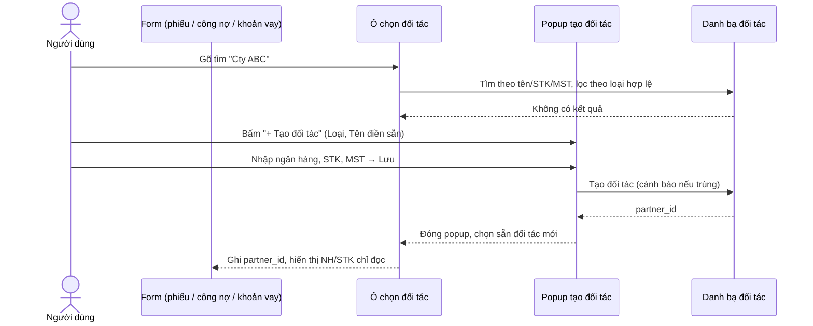

### 5.3 Màn hình Đối tác

- **Danh sách**: lọc theo loại, trạng thái, tìm theo tên/STK/MST. Cột tóm tắt:
  - KH, NCC: *Còn phải thu*, *Còn phải trả*, *Quá hạn*
  - NH: *Dư nợ*, *Đáo hạn gần nhất*
  - Tổng thu / tổng chi đã thực thi trong kỳ.
- **CRUD**: thêm, sửa, ngừng/kích hoạt lại, xoá (chỉ khi chưa phát sinh).
- **Sao chép từ công ty khác**: chọn công ty nguồn (người dùng có quyền xem) → chọn các đối tác → tạo bản sao **mới, có ID riêng** trong công ty hiện tại (cùng loại, tên, ngân hàng, STK, MST). Hai bản ghi độc lập, sửa bên này không ảnh hưởng bên kia; vẫn áp dụng cảnh báo trùng.
- **Chi tiết đối tác**: thông tin, các tab *Phiếu thu/chi*, *Công nợ*, *Nợ ngân hàng*, *Lịch sử*.
- **Nút thao tác trên mỗi đối tác**:

| Nút | Khách hàng | Nhà cung cấp | Ngân hàng |
| --- | --- | --- | --- |
| **Thu** | Phiếu thu, đối tác điền sẵn | Phiếu thu (VD NCC hoàn tiền) | Phiếu thu; gợi ý bật "Khoản vay ngân hàng" |
| **Chi** | Phiếu chi (VD hoàn tiền KH) | Phiếu chi, đối tác điền sẵn | Phiếu chi (VD phí, trả lãi) |
| **Ghi nợ** | Khoản công nợ mới — chọn **Phải thu** / **Phải trả** | Khoản công nợ mới — chọn **Phải thu** / **Phải trả** | Khoản **nợ ngân hàng** mới |
| **Trả nợ** | Khoản phải thu → phiếu **thu**; khoản phải trả → phiếu **chi**; kèm liên kết cấn trừ | như Khách hàng | Phiếu **chi** trả nợ vay (gốc/lãi) |

"Trả nợ" mở danh sách khoản còn dư của đối tác → người dùng chọn một/nhiều khoản và số tiền phân bổ → hệ thống tạo **phiếu thu cho các khoản phải thu** và **phiếu chi cho các khoản phải trả** (chọn cả hai hướng ⇒ tạo 2 phiếu), **đã gắn sẵn liên kết** cấn trừ / trả nợ (mục 11).

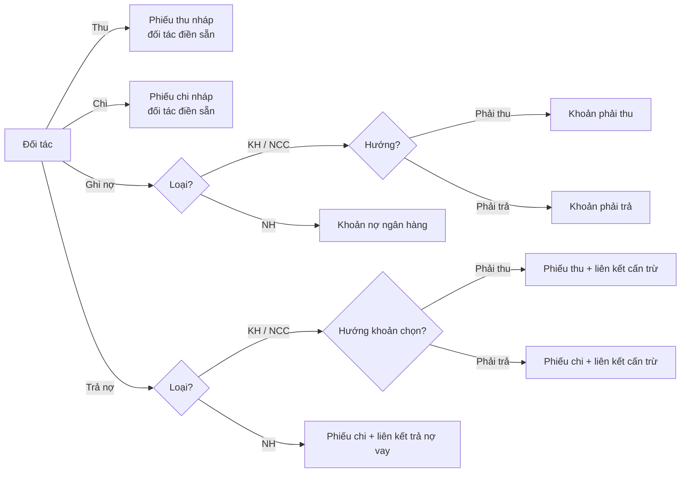

**User stories**

- **US-PAR-01** — Là *KTV*, tôi muốn tạo đối tác với tên, loại, ngân hàng, số TK, để chọn lại nhanh khi lập phiếu.
- **US-PAR-02** — Là *KTV*, khi lập phiếu/công nợ/khoản vay mà chưa có đối tác, tôi muốn mở popup tạo đối tác ngay trên form, lưu xong thì đối tác được chọn sẵn, không mất dữ liệu đang nhập.
- **US-PAR-08** — Là *KTT*, tôi muốn sửa tên/ngân hàng/STK của đối tác bất cứ lúc nào và mọi phiếu liên quan hiển thị thông tin mới, còn lịch sử sửa vẫn tra được.
- **US-PAR-03** — Là *KTT*, tôi muốn xem trên một màn hình với mỗi khách hàng/NCC: còn phải thu, còn phải trả bao nhiêu; mỗi ngân hàng dư nợ bao nhiêu.
- **US-PAR-04** — Là *KTV*, tôi muốn bấm **Trả nợ** trên một NCC, chọn các khoản phải trả và số tiền, để hệ thống tạo phiếu chi đã cấn trừ sẵn.
- **US-PAR-05** — Là *KTV*, tôi muốn bấm **Ghi nợ** trên một ngân hàng để tạo khoản vay mới với đối tác điền sẵn.
- **US-PAR-06** — Là *KTT*, tôi muốn ngừng giao dịch một đối tác mà không làm mất lịch sử phiếu cũ.
- **US-PAR-07** — Là *KTT*, tôi muốn được cảnh báo khi tạo đối tác trùng tên hoặc trùng số tài khoản với đối tác đã có.
- **US-PAR-09** — Là *KTV*, tôi muốn sao chép đối tác từ công ty khác trong tập đoàn sang công ty mình, để không phải nhập lại.

---

## 6. Phiếu thu / Phiếu chi

### 6.1 Trường dữ liệu

Giữ toàn bộ trường v1; **[v2]** đánh dấu phần thay đổi.

| Nhóm | Trường |
| --- | --- |
| Nhận diện | Công ty, mã phiếu tự sinh, loại (thu/chi), bộ phận, người lập, ngày tạo |
| Nghiệp vụ | Tiêu đề, nội dung/mục đích, danh mục thu/chi, **Đối tác [v2 — bắt buộc, chọn theo ID qua ô chọn đối tác, mục 5.2]** (tên – ngân hàng – STK – MST hiển thị từ đối tác), hợp đồng (số, giá trị, ngày ký), mã công nợ, **Tags [v2 — MỚI]** |
| Số tiền | Số tiền, tiền tệ, tỷ giá (nếu ngoại tệ), số thực thu/thực chi |
| Tài khoản | Phiếu thu: **tài khoản đích**; phiếu chi: **tài khoản nguồn**; quỹ tiền mặt hoặc ngân hàng; tài khoản Tổng công ty phụ trách (nếu dùng) |
| Kế hoạch | Ngày dự kiến thu/chi, ngày nghiệp vụ, mức ưu tiên (thấp/thường/cao/khẩn), ngân sách & dòng ngân sách, trong/ngoài kế hoạch |
| Kiểm soát (tự ghi) | Chuỗi duyệt theo matrix, ý kiến từng cấp, lý do duyệt vượt cấp, lịch sử trạng thái |
| Thực hiện | Ngày thực thi, số thực thu/chi, tài khoản thực thi, số tham chiếu NH, người thực hiện, chứng từ sau thanh toán |
| **Tuỳ chọn tự động [v2]** | "Khoản vay ngân hàng" (phiếu thu), "Vay ngân hàng để chi" (phiếu chi) — mục 11 |
| **Liên kết [v2]** | Danh sách liên kết với công nợ / nợ ngân hàng / phiếu khác (mục 11) |

### 6.2 Tags [v2 — MỚI]

- Một phiếu có **nhiều tag**. Tag thuộc **danh bạ tag của công ty**.
- Ô tag: gõ để tìm; nếu chưa có → dòng "**+ Tạo tag "…"**" ngay trong danh sách gợi ý (cần quyền `tag:create`).
- Tag chuẩn hoá chống trùng (bỏ khoảng trắng thừa, không phân biệt hoa thường).
- Quản lý tag (KTT): đổi tên, đổi màu, **gộp** 2 tag (cập nhật mọi phiếu), ẩn tag không dùng.
- Tag **sửa được cả sau khi duyệt** (không ảnh hưởng tiền) nhưng ghi lịch sử.
- Danh sách phiếu, báo cáo thu-chi, dashboard **lọc / nhóm theo tag**.
- Tag **không dùng chung** giữa các công ty. Báo cáo hợp nhất (chọn "Tất cả công ty") **nhóm theo tên tag** đã chuẩn hoá — tag cùng tên ở các công ty được cộng chung.
- Khác với **Danh mục**: danh mục là phân loại chuẩn (1 phiếu – 1 danh mục, quyết định chứng từ bắt buộc & matrix); tag là nhãn tự do (dự án, công trình, đợt…).

### 6.3 Loại đặc biệt (như v1)

- **Chuyển tiền nội bộ** giữa các công ty/Tổng công ty: phiếu chi của công ty A cho tài khoản của công ty B → khi thực thi, **tự sinh phiếu thu** ở B (quy tắc R1, mục 11). Không tính là doanh thu/chi phí trong báo cáo.
- **Số tiền & tài khoản chi do cấp duyệt quyết định** (giữ logic code hiện tại — không còn chi từng phần / chi nhiều đợt):
  - Mỗi phiếu chi được thực thi **một lần duy nhất** và đóng ngay.
  - Khi duyệt, cấp duyệt được **sửa số tiền** và **đổi tài khoản nguồn** (trong phạm vi công ty hoặc tài khoản Tổng công ty). **Cấp duyệt cuối** là người chốt: số tiền và tài khoản sau lần duyệt cuối là số kế toán phải chi.
  - Giảm số tiền: sửa trực tiếp. **Tăng** số tiền: người duyệt phải gõ lại số tiền mới để xác nhận.
  - Số tiền hiệu lực được kiểm tra với **hạn mức duyệt** của người duyệt; mỗi lần đổi ghi lịch sử (trước → sau) và số tiền tại thời điểm quyết định của từng cấp.
  - Muốn chi thành nhiều đợt ⇒ lập nhiều phiếu chi.
- **Khoản chi định kỳ**: quy tắc (lương, thuê nhà, lãi vay…) tự tạo phiếu nháp theo kỳ và nhắc trước 7/3/1 ngày.
- **Chứng từ bắt buộc** theo danh mục/loại phiếu, cấu hình được; thiếu → cảnh báo "Hồ sơ thiếu chứng từ".

**User stories**

- **US-VOU-01** — Là *KTV*, tôi muốn lập phiếu chi chọn đối tác, tài khoản nguồn, số tiền, danh mục, đính kèm chứng từ và gửi duyệt.
- **US-VOU-02** — Là *KTV*, tôi muốn gắn nhiều tag cho phiếu, chọn tag có sẵn hoặc tạo tag mới ngay trong ô chọn.
- **US-VOU-03** — Là *Giám đốc*, tôi muốn lọc tổng chi theo tag "Dự án X" trong tháng.
- **US-VOU-04** — Là *KTT*, tôi muốn gộp tag "DA-X" và "Dự án X" thành một.
- **US-VOU-05** — Là *KTV*, khi phiếu bị yêu cầu bổ sung, tôi muốn sửa và gửi lại mà vẫn giữ lịch sử duyệt cũ.
- **US-VOU-06** — Là *Giám đốc (cấp duyệt cuối)*, tôi muốn quyết định số tiền được chi và tài khoản chi ngay khi duyệt, để kế toán chỉ việc thực thi đúng như đã chốt.

---

## 7. Quy trình phê duyệt

### 7.1 Trạng thái phiếu (như v1)

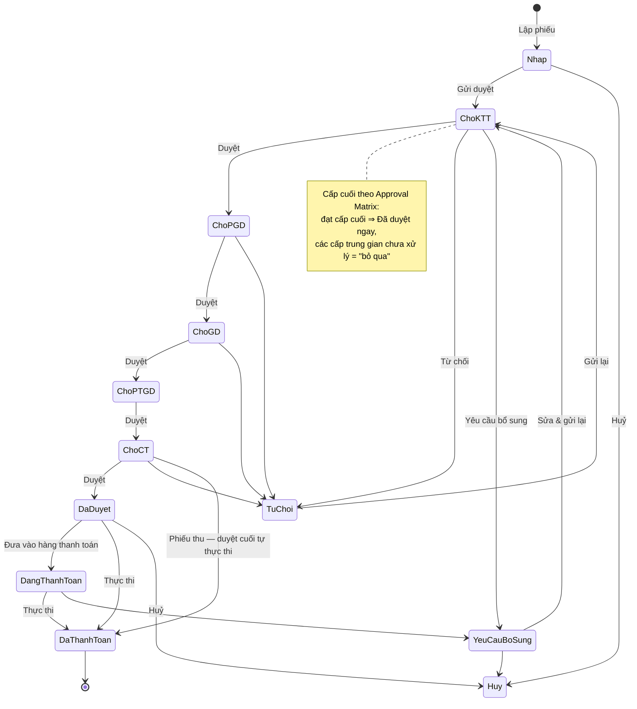

### 7.2 Approval Matrix & fast-track (như v1)

- Matrix là **dữ liệu cấu hình**: theo công ty, loại phiếu, danh mục, khoảng số tiền → chuỗi cấp duyệt + SLA từng cấp. Ví dụ mặc định:

| Số tiền | Chuỗi duyệt |
| --- | --- |
| < 50 triệu | KTT → PGĐ |
| 50 triệu – 5 tỷ | KTT → PGĐ → GĐ |
| > 5 tỷ | KTT → PGĐ → GĐ → (PTGĐ) → Chủ tịch, kèm cảnh báo đặc biệt |

- Phiếu gửi đi thì **mọi cấp đều thấy và được duyệt ngay** (duyệt vượt cấp, ghi lý do). "Chờ tôi duyệt" chỉ liệt kê phiếu mà mình là **cấp thấp nhất còn chờ**.
- Trạng thái luôn phản ánh "đang nằm ở bàn ai"; nhãn "Đã duyệt trước bởi …" khi cấp cao duyệt trước.
- Khi duyệt, cấp duyệt được **đổi tài khoản đích/nguồn** trong phạm vi công ty (hoặc tài khoản Tổng công ty) — ghi lịch sử, chuyển số dự kiến.
- Phiếu chi: cấp duyệt được **sửa số tiền** (tăng phải gõ lại xác nhận); giá trị sau **cấp duyệt cuối** là số được chi (mục 6.3).
- Khoản lớn vượt ngưỡng hoặc ngoài ngân sách: người duyệt phải gõ lại số tiền để xác nhận.
- Khi duyệt **không chặn** theo số dư tài khoản; chỉ chặn ở bước thực thi phiếu chi (mục 8).
- Chống thao tác trùng (double click / retry) và xung đột sửa đồng thời (phiên bản phiếu).
- Mỗi chuyển trạng thái: ghi lịch sử, thông báo cấp kế tiếp (web + email), **phát sự kiện nghiệp vụ** cho bộ máy tự động **[v2]**.

### 7.3 Phiếu đảo hạn (như v1)

Kế toán lập phương án (khoản vay, dư nợ, ngày đáo hạn, số cần đảo, nguồn tiền, phương án, phí, lãi suất mới, TSĐB, đề xuất) → duyệt theo matrix riêng của loại "đảo hạn" → thực hiện → **cập nhật kết quả** (ngày, số HĐ mới, hạn mức mới, lãi suất mới, phí thực tế).

**User stories**

- **US-APR-01** — Là *Giám đốc*, tôi muốn thấy "N khoản chờ tôi duyệt — tổng X tỷ" và duyệt / từ chối / yêu cầu bổ sung trên điện thoại.
- **US-APR-02** — Là *Chủ tịch*, tôi muốn duyệt vượt cấp một phiếu khẩn và ghi lý do.
- **US-APR-03** — Là *KTT*, tôi muốn đổi tài khoản nguồn của phiếu chi khi duyệt vì tài khoản ban đầu không đủ tiền.
- **US-APR-04** — Là *Chủ tịch*, tôi muốn cấu hình ngưỡng tiền → chuỗi duyệt cho từng công ty mà không cần lập trình.
- **US-APR-05** — Là *PGĐ*, tôi muốn uỷ quyền duyệt cho người khác trong thời gian nghỉ phép.

---

## 8. Thực thi & sổ cái dòng tiền

- **Phiếu chi — thực thi** (kế toán, một lần): nhập ngày thực tế, số tham chiếu ngân hàng, đính kèm UNC → phiếu chuyển **Đã thanh toán**. Số tiền và tài khoản nguồn mặc định theo quyết định của cấp duyệt cuối. Hệ thống **chặn nếu số dư tài khoản nguồn không đủ** tại thời điểm thực thi.
- **Phiếu thu — tự thực thi**: duyệt xong cấp cuối ⇒ hệ thống tự chuyển **Đã thanh toán** và cộng tiền vào tài khoản đích (ngày thực thi = ngày duyệt), không cần bước thực thi riêng.
- Mỗi lần thực thi sinh **bút toán sổ cái** trên tài khoản tiền: phiếu thu → *vào*; phiếu chi → *ra*; chuyển nội bộ → cặp ra/vào đối ứng.
- Sổ cái **chỉ thêm**: điều chỉnh bằng bút toán đảo, có khoá chống ghi trùng. Số dư ngày dựng lại được hoàn toàn từ sổ cái.
- Huỷ/xoá phiếu đã thực thi (quyền đặc biệt) → sinh bút toán đảo và dựng lại số dư.
- Thực thi là thời điểm **liên kết cấn trừ / trả nợ có hiệu lực** (mục 9, 10).

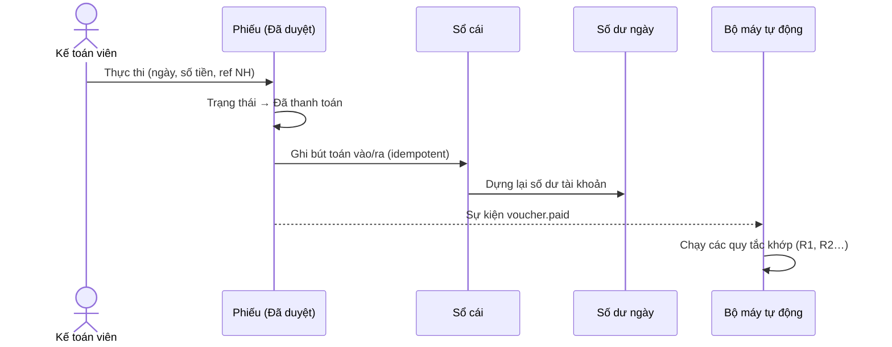

**User stories**

- **US-EXE-01** — Là *KTV*, tôi muốn đánh dấu phiếu đã chi kèm số tham chiếu và UNC, để số dư tài khoản cập nhật ngay.
- **US-EXE-02** — Là *KTT*, tôi muốn mọi thay đổi số dư truy được về phiếu và người thực hiện.

---

## 9. Công nợ (phải thu / phải trả)

### 9.1 Định nghĩa

Khoản công nợ ghi nhận **nghĩa vụ tiền** với đối tác, chưa phải dòng tiền.

| Trường | Ghi chú |
| --- | --- |
| Mã, công ty | Tự sinh |
| **Đối tác [v2 — bắt buộc]** | Loại Khách hàng hoặc Nhà cung cấp |
| **Hướng [v2 — THAY ĐỔI]** | **Phải thu** (đối tác nợ công ty) / **Phải trả** (công ty nợ đối tác) — người dùng chọn, **không suy ra từ loại đối tác**. VD: ứng trước cho NCC = phải thu NCC; KH đặt cọc / được hoàn tiền = phải trả KH. |
| Tài khoản kế toán | Tham chiếu theo loại đối tác (KH 131, NCC 331); hướng thể hiện dư Nợ / dư Có |
| Bút toán Nợ / Có | Như v1 (hai chiều) |
| Giá trị, tiền tệ | |
| Hợp đồng, hạn thanh toán, mức ưu tiên, ghi chú | |
| Chứng từ | |
| Liên kết cấn trừ | Danh sách phiếu thu/chi + số tiền phân bổ |

**Chỉ tiêu tính khi đọc** (không lưu): *Đã cấn trừ* = Σ số phân bổ của các phiếu liên kết **đã thực thi**; *Còn lại* = Giá trị − Đã cấn trừ; *Quá hạn N ngày*; tuổi nợ (aging).

### 9.2 Cấn trừ

- Gán phiếu thu (với khoản phải thu) / phiếu chi (với khoản phải trả) **cùng công ty, cùng đối tác** vào khoản công nợ với số tiền phân bổ.
- Một phiếu có thể phân bổ cho nhiều khoản; một khoản nhận từ nhiều phiếu; tổng phân bổ của phiếu ≤ số tiền phiếu.
- Liên kết chỉ **có hiệu lực khi phiếu đã thực thi**; huỷ phiếu / gỡ liên kết → số còn lại tính lại ngay.
- Tạo liên kết từ 3 phía: từ khoản công nợ, từ phiếu, từ nút **Trả nợ** trên đối tác.

**User stories**

- **US-DEBT-01** — Là *KTV*, tôi muốn ghi khoản công nợ cho một KH/NCC, chọn hướng phải thu hoặc phải trả, theo hợp đồng và hạn thanh toán.
- **US-DEBT-04** — Là *KTV*, tôi muốn ghi khoản ứng trước cho NCC là **phải thu** NCC, và khoản KH đặt cọc là **phải trả** KH.
- **US-DEBT-02** — Là *KTV*, tôi muốn gán phiếu chi đã có vào khoản phải trả để giảm số còn phải trả.
- **US-DEBT-03** — Là *Giám đốc*, tôi muốn xem báo cáo tuổi nợ phải thu / phải trả theo từng đối tác.

---

## 10. Nợ ngân hàng & đảo hạn

### 10.1 Khoản nợ ngân hàng

| Trường | Ghi chú |
| --- | --- |
| Mã, công ty | Tự sinh `NHD-…` |
| **Đối tác ngân hàng [v2 — bắt buộc]** | Thay cho ô nhập tự do "tên ngân hàng" của v1 |
| Số HĐ tín dụng, chi nhánh | |
| Số tiền vay (gốc), hạn mức | |
| Lãi suất, kỳ hạn (tháng), ngày giải ngân, **hạn thanh toán (đáo hạn)** | |
| Kỳ trả lãi/gốc, phương thức trả (chỉ trả lãi / gốc đều) | Sinh lịch trả nợ |
| TSĐB, người phụ trách, ghi chú, chứng từ | |
| **Trạng thái [v2 — mở rộng]** | xem 10.2 |
| **Nguồn gốc [v2]** | Thủ công / tự động (quy tắc nào, từ phiếu nào) |

Chỉ tiêu tính khi đọc: *Đã trả gốc* = Σ phiếu chi trả nợ đã thực thi được gán; *Dư nợ* = Gốc − Đã trả; *Số ngày tới đáo hạn* → mức cảnh báo (hôm nay / ≤3 ngày: đỏ; 4–7: cam; 8–30: vàng).

### 10.2 Vòng đời khoản nợ [v2 — THAY ĐỔI]

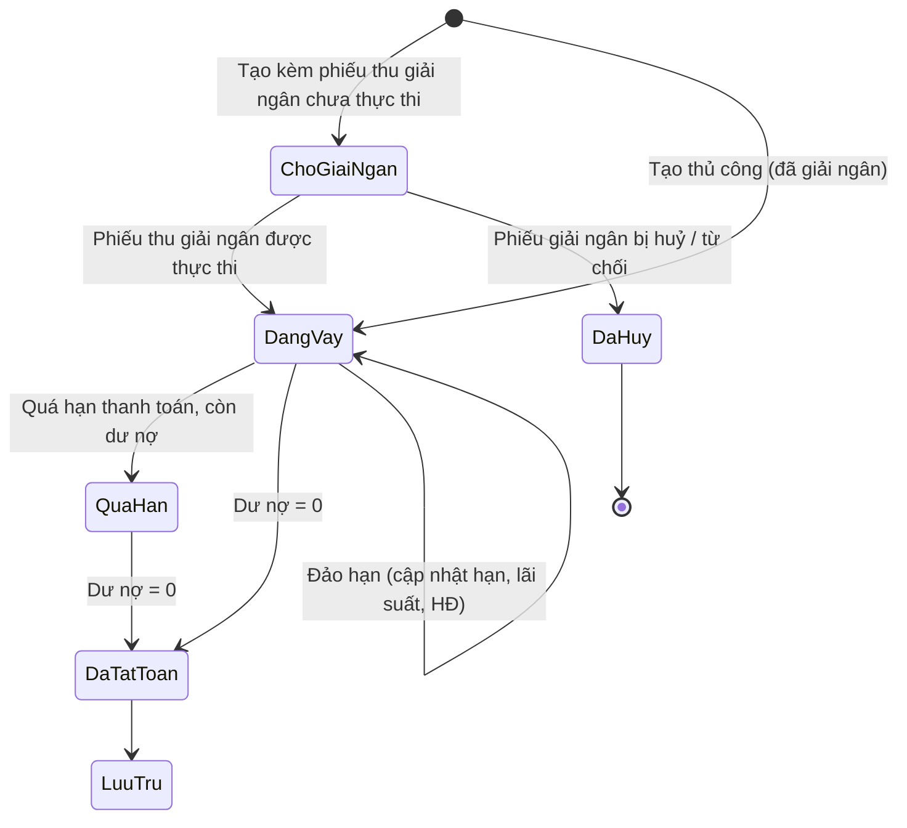

- **Chờ giải ngân**: khoản nợ đã được lập & liên kết với phiếu thu giải ngân nhưng tiền chưa về. **Không** tính vào dư nợ, hiển thị riêng ("Sắp giải ngân") trên dự báo dòng tiền.
- **Đang vay**: tính vào dư nợ, bảng đáo hạn, cảnh báo.

### 10.3 Trả nợ & đảo hạn

- Trả nợ: phiếu chi (cùng công ty, đối tác = ngân hàng) liên kết **trả nợ** với khoản vay; có hiệu lực khi phiếu thực thi. Có thể tách **gốc / lãi / phí** trong số phân bổ **[v2]** để dư nợ chỉ trừ phần gốc.
- Đảo hạn: màn hình riêng (bảng đáo hạn, mức cảnh báo, số cần chuẩn bị), phiếu đảo hạn qua phê duyệt (mục 7.3), cập nhật kết quả vào khoản vay.
- Lịch trả nợ sinh theo kỳ & phương thức; nhập khẩu danh sách khoản vay từ Excel (như v1).

**User stories**

- **US-LOAN-01** — Là *KTV*, tôi muốn tạo khoản vay chọn đối tác ngân hàng, nhập gốc, lãi suất, kỳ hạn, hạn thanh toán.
- **US-LOAN-02** — Là *Giám đốc*, tôi muốn thấy dư nợ theo từng ngân hàng và các khoản đáo hạn trong 7/30 ngày.
- **US-LOAN-03** — Là *KTV*, tôi muốn gán phiếu chi trả nợ vào khoản vay, tách gốc và lãi. *(P1: một số tiền trả nợ; tách gốc/lãi/phí ở P2.)*
- **US-LOAN-04** — Là *KTT*, tôi muốn lập phương án đảo hạn và cập nhật kết quả sau khi ngân hàng ký HĐ mới.

---

## 11. Liên kết nghiệp vụ & quy trình tự động [v2 — MỚI]

### 11.1 Vấn đề của v1

v1 có các liên kết/tự động rải rác, mỗi cái một kiểu lưu:

| v1 | Cách lưu |
| --- | --- |
| Cấn trừ công nợ | mảng `document_links` trên phiếu công nợ |
| Trả nợ vay | mảng `repayment_links` trên khoản vay |
| Phiếu thu tự động từ chuyển nội bộ | `auto_source_document_id` trên phiếu thu, nhận diện qua chuỗi "Mã công ty - NH - STK" |
| Nợ NH tự động từ phiếu thu | cờ `create_bank_debt` + `auto_source_document_id` trên khoản vay |

Thêm quy trình mới ⇒ thêm trường mới, thêm code rải rác, khó truy vết "cái gì sinh ra cái gì", khó xử lý khi phiếu gốc bị huỷ.

### 11.2 Thiết kế v2: 3 khái niệm

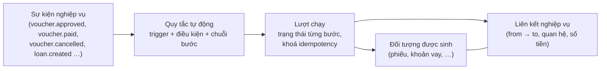

**(1) Liên kết nghiệp vụ** — một bảng chung cho mọi quan hệ giữa hai đối tượng:

| Trường | Ý nghĩa |
| --- | --- |
| Công ty | |
| Từ (loại, id) | VD phiếu chi `PC-…` |
| Đến (loại, id) | VD khoản vay `NHD-…` |
| **Quan hệ** | xem bảng dưới |
| Số tiền phân bổ | nếu quan hệ có tiền; có thể tách gốc/lãi/phí |
| Nguồn | `Thủ công` (ai gán) / `Tự động` (lượt chạy nào) |
| Trạng thái | `Hiệu lực` / `Đã gỡ` (gỡ = đánh dấu, không xoá; có người gỡ, lý do) |

| Quan hệ | Từ → Đến | Ý nghĩa | Có hiệu lực khi |
| --- | --- | --- | --- |
| `offset` | Phiếu thu/chi → Công nợ | Cấn trừ phải thu/phải trả | phiếu đã thực thi |
| `repayment` | Phiếu chi → Nợ NH | Trả nợ vay (gốc/lãi/phí) | phiếu đã thực thi |
| `disbursement` | Phiếu thu → Nợ NH | Phiếu thu là tiền giải ngân của khoản vay | phiếu đã thực thi ⇒ khoản vay `Đang vay` |
| `funded_by` | Phiếu chi → Nợ NH | Khoản chi được tài trợ bằng khoản vay | ngay khi tạo |
| `generated` | Đối tượng nguồn → Đối tượng sinh | Truy vết tự động (VD phiếu chi → phiếu thu tự động) | ngay khi tạo |
| `internal_transfer` | Phiếu chi (A) → Phiếu thu (B) | Cặp chuyển tiền nội bộ | phiếu chi thực thi |

Quy tắc kiểm tra khi gán (dù thủ công hay tự động): cùng công ty (trừ `internal_transfer`); đối tác khớp và đúng loại; tổng phân bổ không vượt số tiền phiếu / giá trị khoản; không tạo trùng cùng cặp + quan hệ.

> Các chỉ tiêu "đã cấn trừ", "đã trả", "dư nợ" **luôn tính từ liên kết hiệu lực + trạng thái phiếu**, không lưu cứng — gỡ liên kết hay huỷ phiếu là tự động đúng.

**(2) Quy tắc tự động** — cấu hình, bật/tắt theo công ty:

| Thuộc tính | Ví dụ |
| --- | --- |
| Mã, tên | `R3 — Vay ngân hàng để chi` |
| Sự kiện kích hoạt | `voucher.approved` |
| Điều kiện | phiếu chi, có cờ "Vay ngân hàng để chi" |
| Chuỗi bước | tạo khoản vay → tạo phiếu thu → thực thi phiếu thu → liên kết |
| Tham số | kỳ hạn mặc định, lệch hạn thanh toán, … |
| Phạm vi | tất cả công ty / danh sách công ty |
| Bật/tắt | |

**(3) Lượt chạy** — mỗi lần quy tắc chạy cho một đối tượng nguồn:

- Khoá idempotency = (quy tắc, đối tượng nguồn, sự kiện) ⇒ chạy lại / retry **không sinh trùng**.
- Ghi trạng thái **từng bước** (`chờ` / `xong` / `lỗi` / `bỏ qua`) và id đối tượng đã sinh; lỗi giữa chừng → lượt chạy `Lỗi`, có nút **Chạy lại** (chỉ chạy các bước chưa xong), cảnh báo cho KTT.
- Hiển thị trên phiếu nguồn: "Quy trình tự động: R3 ✔ — đã tạo NHD-2026-0007, PT-2026-00123 (đã thực thi)".
- Đối tượng sinh tự động mang nhãn **Tự động**, kế thừa người duyệt của phiếu nguồn (người thực hiện ghi là người kích hoạt sự kiện), có lịch sử `auto_create`.

**Sự kiện nghiệp vụ** phát sau mỗi thay đổi trạng thái đã ghi thành công (outbox): `voucher.created`, `voucher.submitted`, `voucher.approved`, `voucher.paid`, `voucher.cancelled`, `voucher.rejected`, `loan.created`, `loan.settled`, `debt.created`… Bộ máy tự động xử lý bất đồng bộ (vài giây), nghiệp vụ gốc **không bao giờ hỏng** vì tự động lỗi.

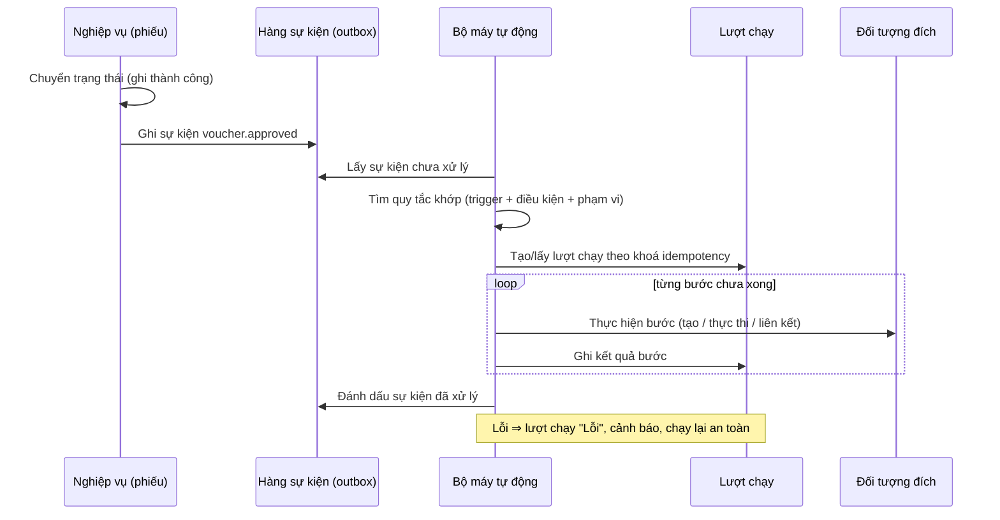

### 11.3 Danh mục quy tắc

| Mã | Tên | Kích hoạt | Trạng thái |
| --- | --- | --- | --- |
| R1 | Chuyển tiền nội bộ → phiếu thu tự động | phiếu chi `paid` mà đối tác/TK nhận là tài khoản tiền của công ty trong hệ thống | v1, chuyển sang bộ máy mới |
| R2 | Phiếu thu đi vay → khoản nợ ngân hàng | phiếu thu có cờ "Khoản vay ngân hàng" | v1 (cờ `create_bank_debt`), **nâng cấp** |
| R3 | Vay ngân hàng để chi | phiếu chi có cờ "Vay ngân hàng để chi" `approved` | **mới** |
| R4 | Khoản vay tất toán → nhắc lưu trữ / giải chấp TSĐB | `loan.settled` | đề xuất |
| R5 | Khoản chi định kỳ → phiếu nháp | lịch | v1, chuyển sang bộ máy mới |
| R6 | Huỷ phiếu nguồn → cảnh báo / huỷ đối tượng sinh chưa phát sinh tiền | `voucher.cancelled` / `rejected` | **mới**, áp cho R2, R3 |

### 11.4 R2 — Phiếu thu đi vay ngân hàng [nâng cấp]

**Nghiệp vụ:** công ty nhận tiền giải ngân của ngân hàng. Phiếu thu đó chính là giải ngân của một khoản nợ ngân hàng.

**Trên form phiếu thu:**

- Ô ☐ **Đây là khoản vay ngân hàng (đi vay)**.
- Bật lên ⇒ **đối tác (bên nộp tiền) bắt buộc là loại Ngân hàng** (ô đối tác chỉ lọc ngân hàng).
- Hai lựa chọn:
  - **(a) Tạo khoản vay mới** — hiện khối thông tin vay: số HĐ tín dụng, lãi suất, kỳ hạn (mặc định 12 tháng), hạn thanh toán (mặc định ngày giải ngân + 11 tháng như v1, sửa được), kỳ trả, phương thức trả, TSĐB. Gốc = số tiền phiếu thu.
  - **(b) Gắn vào khoản vay đã có** — chọn một khoản vay của cùng đối tác ngân hàng đang `Chờ giải ngân` (hoặc `Đang vay` nếu giải ngân nhiều đợt).
  - Hoặc **để sau** — phiếu chỉ mang cờ, liên kết thủ công sau.
- **Thời điểm tạo khoản vay** (lựa chọn (a)): tạo **ngay khi lưu phiếu thu** ở trạng thái `Chờ giải ngân` và liên kết `disbursement`. Khi phiếu thu được sửa trong lúc chưa duyệt, thông tin khoản vay đồng bộ theo. Nếu quy tắc được cấu hình "tạo khi duyệt" thì khoản vay được tạo lúc phiếu đạt `Đã duyệt`.
- Phiếu thu **thực thi** ⇒ khoản vay chuyển `Đang vay`, ngày giải ngân = ngày thực thi, gốc = số thực thu.
- Phiếu thu **bị huỷ / từ chối hẳn** ⇒ khoản vay `Chờ giải ngân` chuyển `Đã huỷ` (R6).

**Gán thủ công sau:** từ khoản vay (nút "Gán phiếu giải ngân") hoặc từ phiếu thu (nút "Gán khoản vay") — chọn đối tượng cùng công ty, cùng đối tác ngân hàng; tổng giải ngân ≤ gốc/hạn mức.

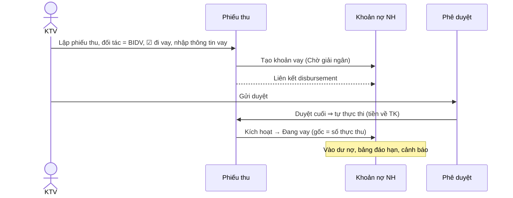

### 11.5 R3 — Phiếu chi "vay ngân hàng để chi" [MỚI]

**Nghiệp vụ:** công ty cần chi cho một đối tác bất kỳ, tiền được tài trợ bằng một khoản vay ngân hàng giải ngân về tài khoản của công ty, sau đó công ty chi từ tài khoản đó.

**Trên form phiếu chi:**

- Ô ☐ **Vay ngân hàng để chi**. Bật lên hiện:
  - **Ngân hàng cho vay** — đối tác loại Ngân hàng (bắt buộc).
  - **Tài khoản nhận giải ngân của công ty** — tài khoản tiền loại ngân hàng của công ty (bắt buộc). Mặc định đặt luôn làm **tài khoản nguồn** của phiếu chi (sửa được).
  - **Số tiền vay** — mặc định = số tiền phiếu chi (có thể khác nếu chỉ vay một phần).
  - Thông tin khoản vay: số HĐ, lãi suất, kỳ hạn, hạn thanh toán, kỳ trả, TSĐB (mặc định như R2).
- Thông tin này **được duyệt cùng phiếu chi** (cấp duyệt thấy rõ "chi bằng vốn vay BIDV X tỷ") và có thể sửa khi phiếu còn sửa được.

**Khi phiếu chi đạt `Đã duyệt` (chưa thực thi)** — R3 chạy:

1. Tạo **khoản nợ ngân hàng** (đối tác = ngân hàng cho vay, gốc = số tiền vay, trạng thái `Chờ giải ngân`), liên kết `funded_by` (phiếu chi → khoản vay).
2. Tạo **phiếu thu** ở cùng công ty: đối tác = ngân hàng cho vay, tài khoản đích = tài khoản nhận giải ngân, số tiền = số tiền vay, nội dung "(Tự động) Giải ngân vay cho phiếu chi PC-…", **kế thừa chuỗi duyệt** của phiếu chi (trạng thái `Đã duyệt`), liên kết `generated` (phiếu chi → phiếu thu) và `disbursement` (phiếu thu → khoản vay).
3. **Thực thi phiếu thu** (ngày thực thi = **ngày duyệt cuối** của phiếu chi — tiền về trước khi chi) ⇒ tiền vào tài khoản nhận; khoản vay → `Đang vay`.
4. Phiếu chi giữ `Đã duyệt`, chờ kế toán **thực thi** như bình thường (từ tài khoản nhận giải ngân).

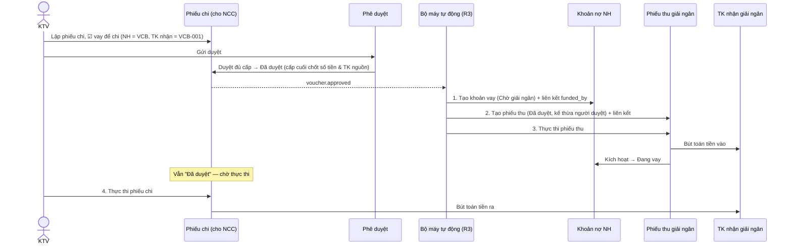

**Ngoại lệ:**

| Tình huống | Xử lý |
| --- | --- |
| Lỗi giữa chừng (VD tạo được khoản vay, lỗi khi tạo phiếu thu) | Lượt chạy `Lỗi`, cảnh báo KTT, **Chạy lại** tiếp từ bước lỗi, không tạo trùng. |
| Phiếu chi bị **huỷ sau khi R3 đã chạy** | Tiền vay đã về ⇒ **không tự huỷ**. R6 cảnh báo KTT: "Khoản vay NHD-… đã giải ngân cho phiếu chi đã huỷ"; xử lý thủ công (trả nợ sớm hoặc gỡ `funded_by` và giữ khoản vay cho mục đích khác). |
| Phiếu chi bị **yêu cầu bổ sung trước khi duyệt xong** | R3 chưa chạy, không có gì phải huỷ. |
| Cấp duyệt sửa số tiền phiếu chi | R3 chạy **sau** duyệt cuối nên dùng số tiền đã chốt; nếu số tiền vay đang bằng số tiền chi thì số tiền vay đi theo số đã chốt. Sau khi R3 chạy, phiếu chi không còn sửa được số tiền. |
| Cờ "Vay để chi" trên phiếu chi **chuyển nội bộ** | Cho phép; R1 và R3 độc lập. |

### 11.6 R1 — Chuyển tiền nội bộ (chuyển từ v1)

- v1 nhận diện qua chuỗi "Mã công ty - Tên NH/quỹ - STK" ở ô đơn vị nhận. **v2:** bỏ nhận diện theo chuỗi; trên phiếu chi chọn **"Nhận: tài khoản nội bộ"** → chọn công ty + tài khoản tiền đích (theo ID tài khoản).
- Phiếu chi `paid` ⇒ tạo phiếu thu ở công ty nhận (đã duyệt, kế thừa người duyệt, thực thi ngay), liên kết `internal_transfer`.
- Báo cáo thu-chi loại trừ cặp nội bộ khỏi doanh thu/chi phí.

### 11.7 User stories

- **US-AUTO-01** — Là *KTV*, khi lập phiếu thu tiền giải ngân, tôi muốn đánh dấu "đi vay", chọn ngân hàng và nhập thông tin vay, để khoản nợ ngân hàng được tạo và liên kết tự động.
- **US-AUTO-02** — Là *KTV*, tôi muốn gán một phiếu thu đã có vào một khoản vay tạo tay trước đó.
- **US-AUTO-03** — Là *KTV*, khi lập phiếu chi cho NCC bằng vốn vay, tôi muốn khai báo ngân hàng cho vay và tài khoản nhận giải ngân, để khi duyệt xong hệ thống tự ghi khoản vay và tiền giải ngân vào tài khoản.
- **US-AUTO-04** — Là *Giám đốc*, khi duyệt phiếu chi tôi muốn thấy rõ phiếu này dùng vốn vay của ngân hàng nào, bao nhiêu, kỳ hạn bao lâu.
- **US-AUTO-05** — Là *KTT*, tôi muốn xem trên mỗi phiếu: quy trình tự động nào đã chạy, sinh ra những gì, có lỗi không, và chạy lại khi lỗi.
- **US-AUTO-06** — Là *KTT*, tôi muốn được cảnh báo khi một phiếu nguồn bị huỷ mà các đối tượng tự sinh đã phát sinh tiền.
- **US-AUTO-07** — Là *Chủ tịch*, tôi muốn bật/tắt từng quy tắc tự động và chỉnh tham số mặc định (kỳ hạn, lệch hạn thanh toán) theo công ty.
- **US-AUTO-08** — Là *KTV*, tôi muốn mở một khoản vay và thấy toàn bộ chuỗi: phiếu chi được tài trợ, phiếu thu giải ngân, các phiếu trả nợ.

---

## 12. Điều hành: Dashboard, dòng tiền, cảnh báo, bản tin, báo cáo

Giữ nguyên v1, bổ sung chiều **đối tác** và **tag**.

| Chức năng | Nội dung | v2 bổ sung |
| --- | --- | --- |
| **Dashboard** | Tiền hiện có (tiền mặt / ngân hàng), thu & chi hôm nay, chờ tôi duyệt (tổng tiền), dư nợ & đáo hạn 7/30 ngày, công nợ quá hạn, dòng tiền 30 ngày; chọn Tất cả / từng công ty | Top đối tác phải thu/phải trả; khoản vay "Chờ giải ngân"; lượt chạy tự động lỗi |
| **Dự báo dòng tiền** | 7/30/60/90 ngày: đầu kỳ, thu, chi dự kiến, cuối kỳ; dưới tối thiểu → đỏ | Gồm giải ngân sắp tới, lịch trả nợ vay |
| **Cảnh báo** | Chờ duyệt quá SLA, đáo hạn, số dư thấp, phải thu quá hạn, vượt ngân sách, thiếu chứng từ, đến hạn thanh toán, dòng tiền âm; web + email | Lượt chạy tự động lỗi; phiếu nguồn huỷ khi đối tượng sinh đã có tiền |
| **Bản tin hàng ngày** | Tổng tiền, thu/chi dự kiến, chờ GĐ duyệt, quá hạn, đảo hạn hôm nay/3/7 ngày, cảnh báo thiếu tiền | – |
| **Báo cáo** (Excel/PDF) | Thu-chi ngày/tháng, số dư NH, công nợ phải thu/phải trả, vay NH, đáo hạn, dòng tiền, chi theo bộ phận/loại/công ty, chờ duyệt, hiệu suất kế toán | Theo **đối tác**, theo **tag**, sổ chi tiết đối tác |
| **Ngân sách** | Hạn mức theo kỳ, dòng theo bộ phận/danh mục, đánh dấu trong/ngoài kế hoạch | – |
| **Tìm kiếm** | Mã phiếu, nội dung, đối tác | Theo tag |
| **Mobile** | Duyệt trên điện thoại, thông báo | – |

---

## 13. Quản trị hệ thống

Như v1: công ty & Tổng công ty, bộ phận, nhân sự & phân công, uỷ quyền, Approval Matrix, danh mục thu/chi (chứng từ bắt buộc), ngân sách, khoản chi định kỳ, quy tắc cảnh báo, cài đặt chung, phiên đăng nhập, audit log, sao lưu (tự động 30 phút, giữ 30 ngày) & khôi phục, đối chiếu toàn vẹn số liệu.

**[v2] bổ sung:**

- **Quy tắc tự động**: danh sách R1…Rn, bật/tắt theo công ty, tham số, lịch sử lượt chạy, chạy lại.
- **Tag**: quản lý theo công ty (đổi tên, màu, gộp, ẩn).
- **Loại liên kết** (chỉ đọc): mô tả quan hệ và ràng buộc.

---

## 14. Mô hình dữ liệu v2

> Ký hiệu: ★ mới · ✎ thay đổi · (không ký hiệu) giữ nguyên v1. Tiền lưu số nguyên đơn vị nhỏ nhất + mã tiền tệ.

### 14.1 Sơ đồ

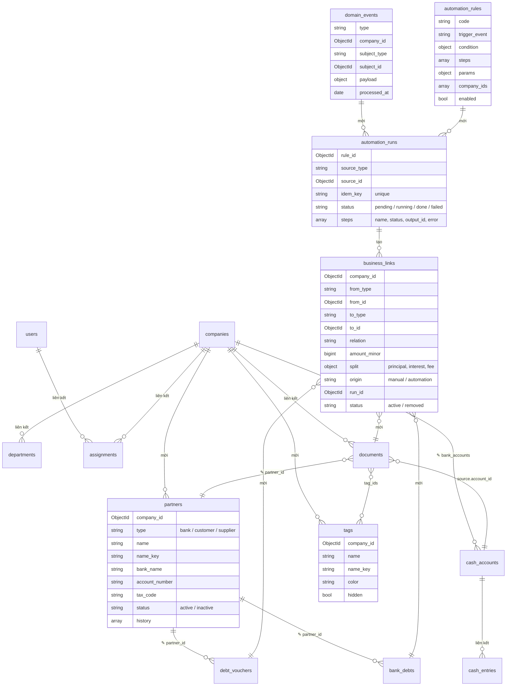

### 14.2 Chi tiết thay đổi theo collection

| Collection | Thay đổi |
| --- | --- |
| `companies` | Giữ. Tổng công ty = `is_group: true`. (Đề xuất thêm `parent_id` nếu sau này có nhiều tầng.) |
| `users`, `assignments`, `departments`, `delegations`, `sessions` | Giữ. |
| `bank_accounts` | Giữ (`kind: cash|bank`). Tên nghiệp vụ: *Tài khoản tiền*. |
| ★ `partners` | Thay `counterparties` (dùng chung tập đoàn, không loại) bằng danh bạ **theo công ty**, có `type`. Khoá = `_id`; **không** unique theo tên/STK (chỉ cảnh báo trùng). Index tìm kiếm `(company_id, type, name_key)`, `(company_id, account_number)`. Có `history[]` ghi mọi lần sửa. |
| ★ `tags` | Unique `(company_id, name_key)`. |
| ✎ `documents` | + `partner_id` (bắt buộc); **bỏ** `payee.*` (tên, MST, NH, STK) — hiển thị qua `partner_id`; + `tag_ids[]`; + `options.loan` (cờ đi vay / vay để chi + thông tin khoản vay dự kiến: `mode: new|existing|later`, `lender_partner_id`, `receive_account_id`, `amount_minor`, `terms{…}`); + `origin {kind: manual|automation, run_id, rule_code}`; bỏ dần `create_bank_debt`, `auto_source_document_id`, `auto_created` (chuyển sang `origin` + `business_links`). |
| ✎ `debt_vouchers` | + `partner_id` (KH/NCC); + `direction: receivable|payable` (độc lập với loại đối tác, thay cặp `account_code` + `side` làm trường nghiệp vụ chính); **bỏ** `party_*`; `document_links` chuyển sang `business_links(relation=offset)`. |
| ✎ `bank_debts` | + `partner_id` (NH); **bỏ** `bank_name`, `branch` nhập tự do (chi nhánh thuộc tên đối tác); + trạng thái `pending_disbursement`, `cancelled`; + `disbursed_at`; `repayment_links` → `business_links(relation=repayment)`; `auto_source_document_id` → `origin` + link `disbursement`. |
| ★ `business_links` | Index `(from_type, from_id)`, `(to_type, to_id)`, unique `(from_id, to_id, relation)` khi `status=active`. |
| ★ `domain_events` | Outbox: ghi cùng lúc đổi trạng thái; job đọc theo `processed_at = null`. TTL dọn sau N ngày đã xử lý. |
| ★ `automation_rules` | Seed R1, R2, R3, R5, R6. Tham số theo công ty ghi đè mặc định. |
| ★ `automation_runs` | Unique `idem_key = rule_code:source_id:event`. |
| ✎ `recurring_rules` | `payee` nhập tự do → `partner_id`. |
| `cash_entries`, `balances_daily`, `bank_transactions`, `approval_matrix`, `categories`, `budgets`, `alerts`, `notifications`, `audit_log`, `jobs`, `settings`, `counters` | Giữ. |

### 14.3 Nguyên tắc thiết kế cho quy trình tự động sau này

0. **Mọi liên kết tới đối tác đi qua `partner_id`** — không lưu, không khớp, không tách chuỗi theo tên/STK; quy tắc tự động cũng xác định đối tác/tài khoản bằng ID.
1. **Đối tượng không biết về quy trình**: không thêm cờ/trường kiểu `auto_xxx_id` lên đối tượng cho mỗi quy trình mới; quan hệ đi qua `business_links`, nguồn gốc qua `origin`.
2. **Sự kiện là hợp đồng**: mọi chuyển trạng thái phát sự kiện; quy trình mới chỉ cần đăng ký sự kiện + điều kiện + bước.
3. **Bước là hàm dùng chung, idempotent**: `create_voucher`, `execute_voucher`, `create_loan`, `activate_loan`, `link`, `notify`, `alert` — mỗi bước nhận khoá idempotency, gọi lại không sinh trùng.
4. **Đi qua nghiệp vụ chuẩn**: bước tự động gọi đúng các hàm nghiệp vụ người dùng gọi (kiểm tra quyền hệ thống, ghi lịch sử, sổ cái), không ghi DB tắt.
5. **Chỉ số suy ra, không lưu cứng**: dư nợ, đã cấn trừ, còn lại = f(liên kết, trạng thái phiếu).
6. **Không huỷ dây chuyền tự động khi đã phát sinh tiền** — chỉ cảnh báo và để con người quyết định.

---

## 15. Chuyển đổi dữ liệu v1 → v2

| Bước | Nội dung |
| --- | --- |
| M1 | Với mỗi công ty: quét phiếu thu/chi, công nợ, nợ NH, khoản chi định kỳ → sinh `partners` theo công ty từ `counterparties` + dữ liệu nhập tự do v1 (`payee`, `party_*`, `bank_name`), gộp theo tên chuẩn hoá + STK. Loại suy ra: công nợ `customer`/`supplier` → KH/NCC; khoản vay → NH; phiếu chỉ có thu/chi → mặc định KH (thu) / NCC (chi), đánh dấu "cần rà soát". |
| M2 | Gán `partner_id` cho documents, debt_vouchers, bank_debts. Phiếu không khớp → đối tác "Chưa xác định" của công ty, đưa vào danh sách rà soát. Sau khi gán xong, các trường đối tác nhập tự do v1 chỉ giữ trong bản sao lưu, không còn dùng. |
| M3 | `document_links` → `business_links(offset)`; `repayment_links` → `business_links(repayment)`; `auto_source_document_id` (phiếu thu nội bộ) → `business_links(internal_transfer)`; (khoản vay tự động) → `business_links(disbursement)` + `origin`. |
| M3b | Công nợ v1: `direction` = `receivable` nếu `side = debit` (dư Nợ), `payable` nếu `side = credit` (dư Có) — đúng cho cả 131 và 331. |
| M4 | Khoản vay hiện có → `active` / `overdue` / `settled` như cũ; không có `pending_disbursement`. |
| M5 | Công nợ loại `employee` (TK 334) của v1: giữ nguyên dữ liệu, chỉ đọc; không sinh đối tác. Loại đối tác "Nhân viên" để giai đoạn sau nếu cần (Q3, mục 17). |
| M6 | Đối chiếu sau chuyển đổi: dư nợ, đã cấn trừ, số dư tài khoản trước = sau. |

---

## 16. Danh mục user story

| Nhóm | Mã | Ưu tiên |
| --- | --- | --- |
| Tổ chức & nhân sự | US-ORG-01…04 | Có sẵn v1 |
| Tài khoản tiền | US-ACC-01…04 | Có sẵn v1 |
| **Đối tác** | US-PAR-01…09 | **P1 — v2** |
| Phiếu thu/chi (+Tags) | US-VOU-01…06 (02–04 mới) | **P1 — v2** (tags) |
| Phê duyệt | US-APR-01…05 | Có sẵn v1 |
| Thực thi | US-EXE-01…02 | Có sẵn v1 |
| Công nợ | US-DEBT-01…04 | v1 + gắn đối tác (P1) |
| Nợ ngân hàng | US-LOAN-01…04 | v1 + gắn đối tác, tách gốc/lãi (P2) |
| **Liên kết & tự động** | US-AUTO-01…08 | **P1** (01, 02, 03, 04, 05) · **P2** (06, 07, 08) |

**Lộ trình đề xuất:**

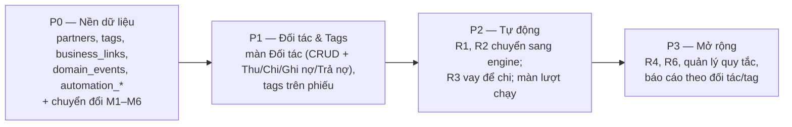

---

## 17. Quyết định đã chốt

Các câu hỏi mở của bản nháp đã được chốt theo đề xuất mặc định; thân tài liệu đã cập nhật theo.

| # | Câu hỏi | Quyết định | Áp dụng tại |
| --- | --- | --- | --- |
| Q1 | Danh bạ đối tác theo **từng công ty** hay **dùng chung tập đoàn** (v1 dùng chung)? | **Theo công ty** (đúng yêu cầu "mỗi công ty có đối tác"); có nút **"Sao chép từ công ty khác"**. | 5.1, 5.3 |
| Q2 | Một đối tác có thể vừa là KH vừa là NCC? | **Không** — mỗi đối tác một loại; cùng một pháp nhân vừa mua vừa bán ⇒ tạo 2 bản ghi khác loại (cảnh báo trùng tên khác loại). | 5.1 |
| Q3 | Công nợ **nhân viên** (TK 334) của v1 có giữ không? | **Giữ dữ liệu cũ, chỉ đọc**; loại đối tác "Nhân viên" để giai đoạn sau nếu cần. | 15 (M5) |
| Q4 | Đối tác có nhiều tài khoản ngân hàng? (yêu cầu ghi 1 ngân hàng + 1 STK) | **1 tài khoản chính**; mở rộng nhiều TK sau nếu cần. | 5.1 |
| Q5 | R2: tạo khoản vay **khi lưu phiếu** hay **khi duyệt**? | **Khi lưu** (trạng thái Chờ giải ngân); cấu hình được theo quy tắc. | 11.4 |
| Q6 | R3: ngày thực thi phiếu thu giải ngân = ngày duyệt hay ngày dự kiến chi? | **Ngày duyệt cuối** của phiếu chi (tiền về trước khi chi). | 11.5 |
| Q7 | R3: số tiền vay khác số tiền chi (vay một phần)? | **Cho phép**, mặc định bằng nhau. | 11.5 |
| Q8 | R3: phiếu thu tự sinh có cần qua duyệt riêng không? | **Không** — kế thừa duyệt của phiếu chi (đã thấy thông tin vay khi duyệt). | 11.5 |
| Q9 | Phiếu chi trả nợ vay: tách gốc/lãi/phí ngay P1? | **Để P2**; P1 ghi nhận một số tiền trả nợ. | 10, 16 |
| Q10 | Tag dùng chung giữa các công ty? | **Theo công ty**; báo cáo hợp nhất nhóm theo tên tag. | 6.2 |
